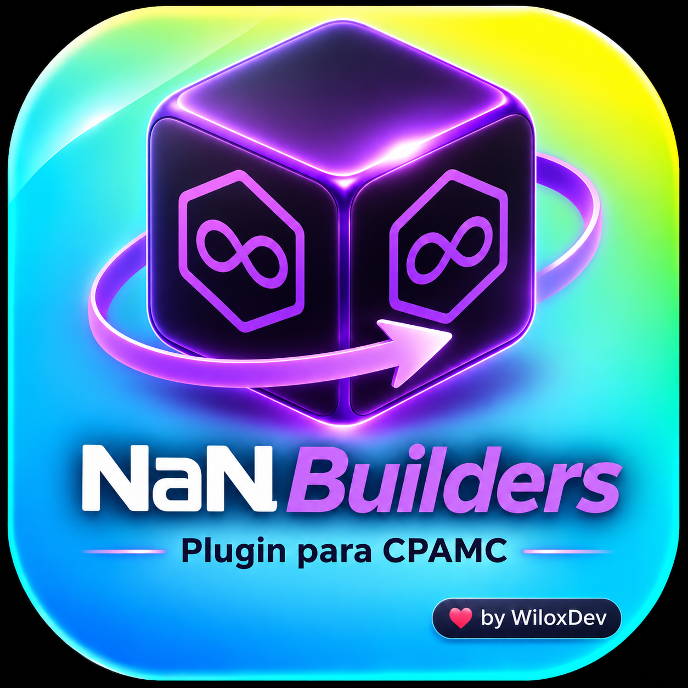

<p align="center">
  
</p>

# 🟣 NaN Builders Plugin for CLI PROXY API CONSOLE (CPAMC)

[](#)
[](https://github.com/WiloxDev/nan-plugin-cpamc/releases)
[](LICENSE)

Plugin de **NaN Builders** para **CLI PROXY API CONSOLE (CPAMC)** y el ecosistema **Gentle-Shell**, con soporte nativo para pools de trabajo continuo en **CPAMC Auto Switcher Pro**.

---

## 🌟 Modelos Soportados

- `deepseek-v4-flash`
- `deepseek-v4-pro`
- `glm-5.3-flash`
- `glm-5.3`
- `mimo-v2.6-flash`
- `qwen3.8-flash`

---

## 🔄 Integración Dual: Standalone & Pools con Auto Switcher Pro

- **Modo Nativo Directo**: Conexión limpia y ligera en CLI PROXY API CONSOLE (CPAMC) y Gentle-Shell para una cuenta individual.
- **Modo Pool de Trabajo Continuo**: Compatible al 100% con **CPAMC Auto Switcher Pro** para crear grupos de cuentas con rotación automática, conmutación por error (failover ante 429/401) y operación ininterrumpida 24/7.
- 💡 **Multi-Cuenta**: También si tienes dos o más cuentas complementa con el plugin Auto Switcher Pro, así podrás tener una Rotación Continua, distribuir el consumo y evitar agotamiento de cuotas.

---

## 🛠️ Compilación e Instalación

Para compilar e instalar directamente en el directorio de plugins de CPAMC:

```bash
make install
```

O compilar manualmente la biblioteca compartida C-ABI (`.so`):

```bash
make build
```

El binario resultante se ubicará en `~/services/cliproxy/plugins/nan-plugin-linux-amd64.so`.
